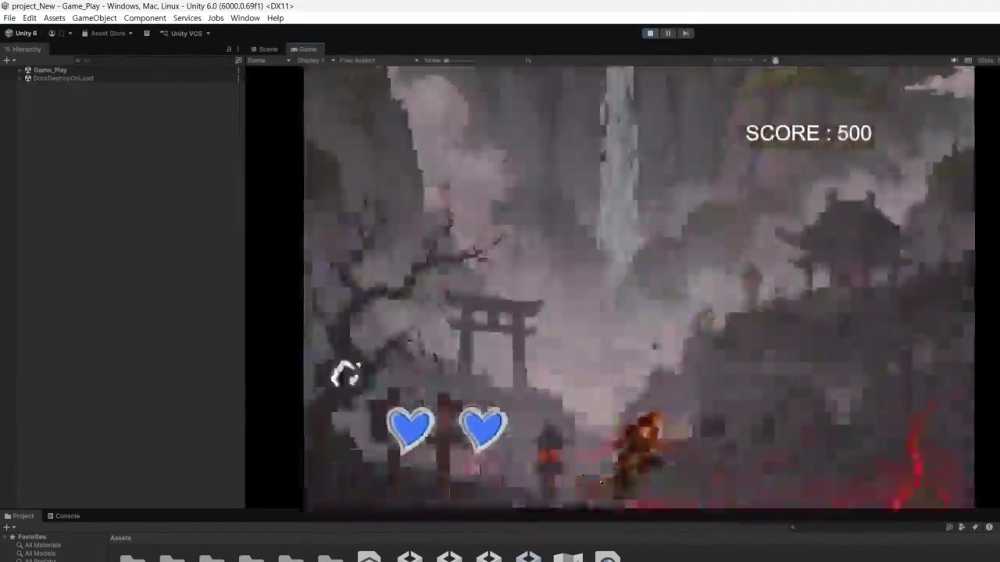
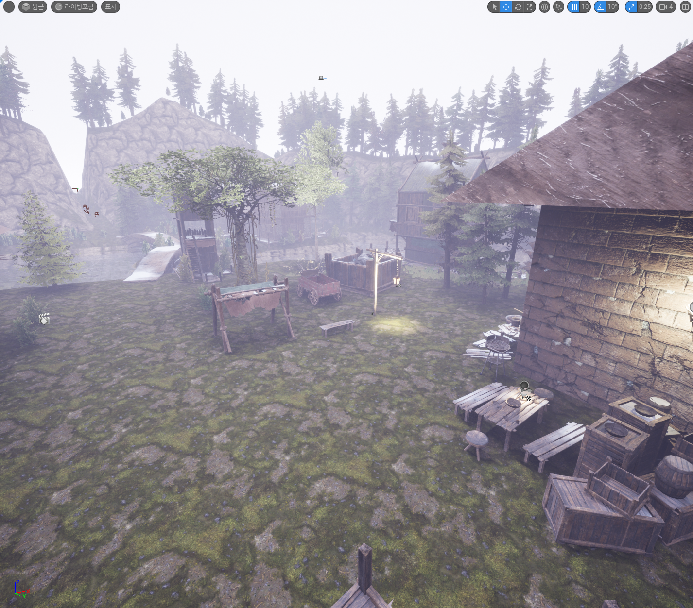

# Unity · Unreal Engine 학습과 제작 기록

**수업에서 배운 내용을 게임과 3D 환경으로 구현한 과정입니다.**

Unity 팀 프로젝트 **손오공**의 코드·시연과 Unreal Engine의 **날짜별 환경 제작 과정**을 모았습니다.

[전체 포트폴리오](https://github.com/seung-gwan/portfolio) · [영상·발표 자료](media/README.md) · [소스 범위와 실행 안내](docs/source-scope.md)

## Unity — 손오공

떨어지는 물체를 공격·방어하거나 피하면서 점수를 얻는 PC용 2D 액션 미니게임입니다.
캐릭터의 3개 레인 이동, 점프, 낙하물 판정, 경고 UI, 체력·점수와 게임오버까지 이어지는 흐름을 구현했습니다.

| 구분 | 담당 |
| --- | --- |
| 팀 | 화천인재 · 2인 팀 프로젝트 |
| 기획 | 유승관 · 이승훈 공동 |
| 게임 구현 전반 | 유승관 |
| 이미지 디자인 | 이승훈 |

**[제작 과정·코드 설명](unity/project_New/README.md)** · **[최종 시연 영상](https://github.com/seung-gwan/game-dev-studies/releases/download/showcase-2026-06/unity-final-gameplay.mp4)** · [Unity 실습 6개 보기](unity/README.md)

## Unreal Engine — 환경 제작과 아포칼립스 구상

실내 조명 실습에서 시작해 지형·건물 배치, 마을과 도시 장면으로 확장한 제작 과정입니다.
스크린샷과 과제 영상, 기획 문서, 발표 자료를 날짜가 확인되는 범위에서 연결했습니다.

**[날짜별 제작 과정](docs/unreal-timeline.md)** · [언리얼 프로젝트·맵](unreal/README.md) · [아포칼립스 기획 정리](docs/unreal-apocalypse-design.md)

## 저장한 자료

| 분야 | 자료 |
| --- | --- |
| Unity | 6개 프로젝트의 C# 스크립트 24개, 장면·프리팹, 패키지와 프로젝트 설정 |
| Unreal Engine | 2개 프로젝트의 학습 맵 8개, 블루프린트·머티리얼, 저장된 외부 액터 데이터 |
| 제작 과정 | 초기 작업 화면, 중간 결과와 마을·도시 장면 |
| 시연 | Unity 초기·최종 영상, Unreal 과제·장면·발표 영상 |

프로젝트 파일은 학습 작업을 선별한 공개본입니다. 원래 사용한 이미지·모델·외부 에셋 팩은 별도 복원이 필요합니다.
제공된 영상의 실행 장면과 이번 정리에서 수행한 파일 검증을 구분하여 [검증 기록](docs/verification.md)에 적었습니다.
