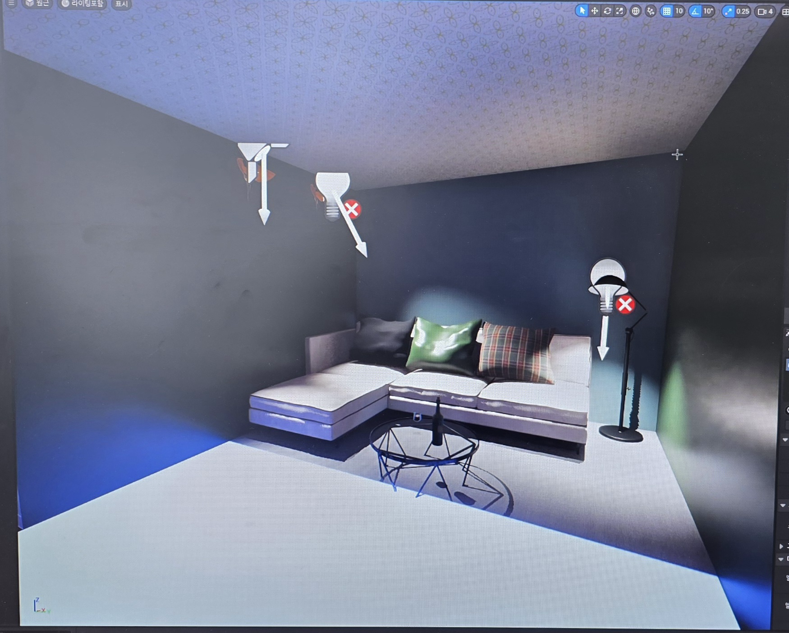
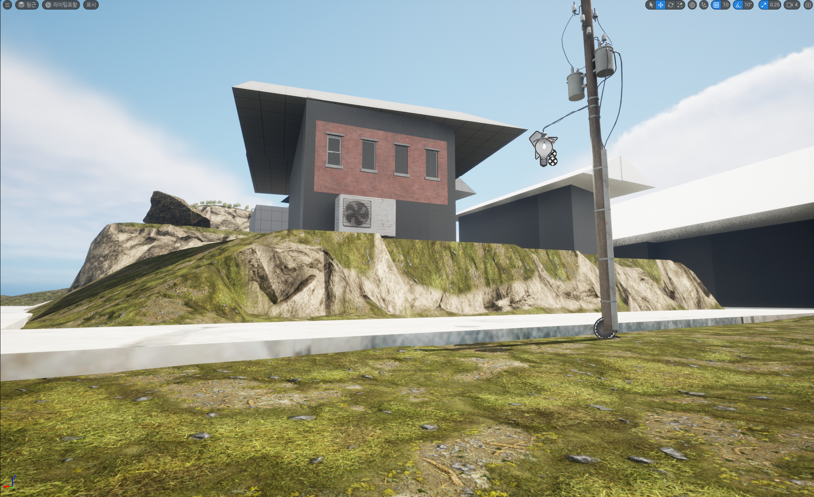
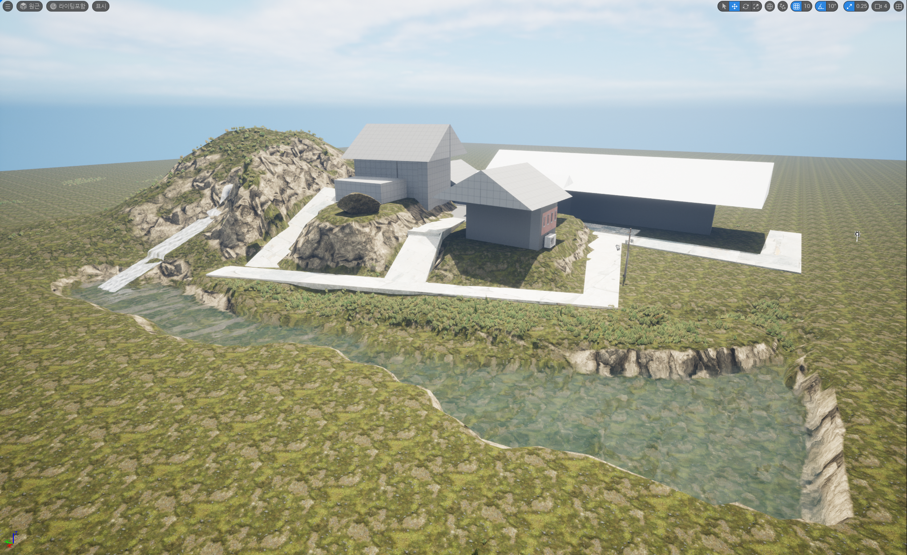
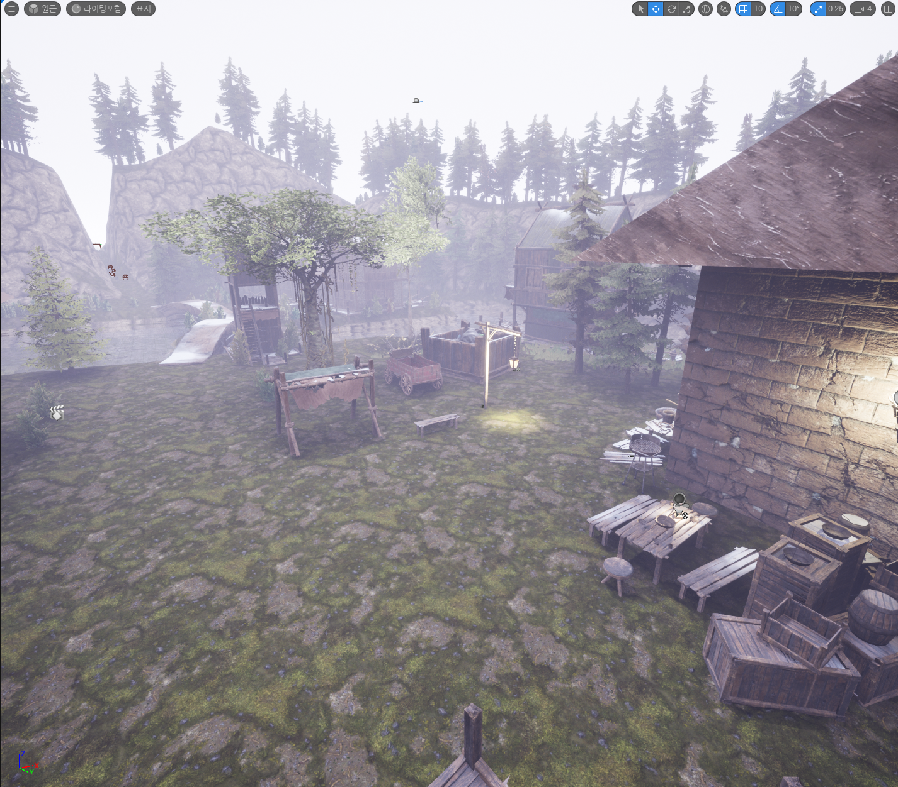
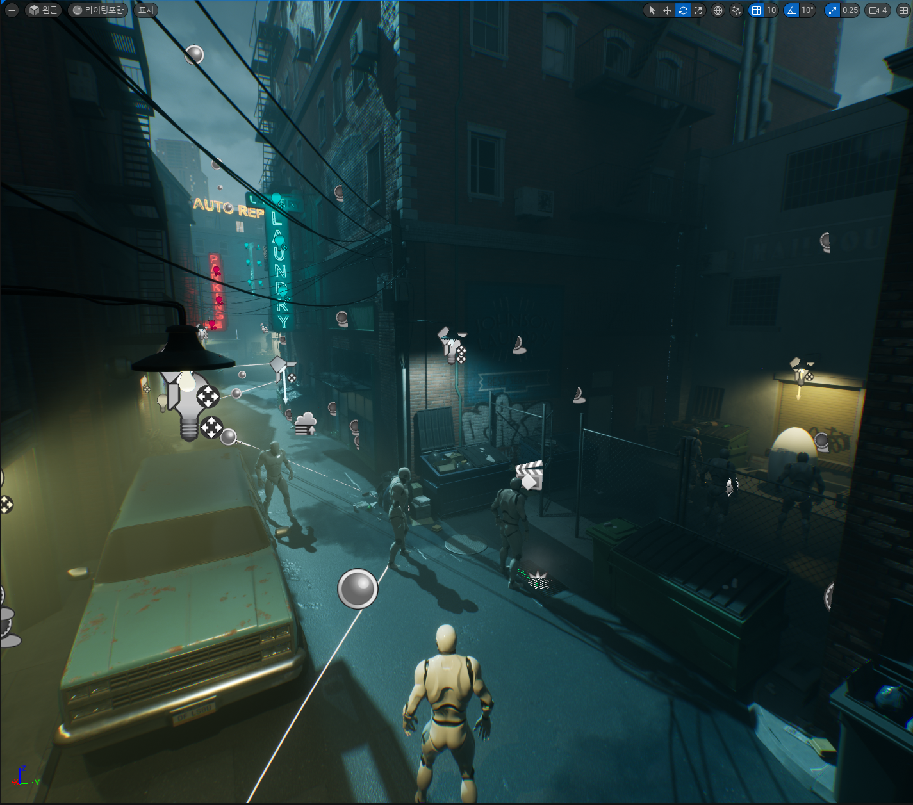
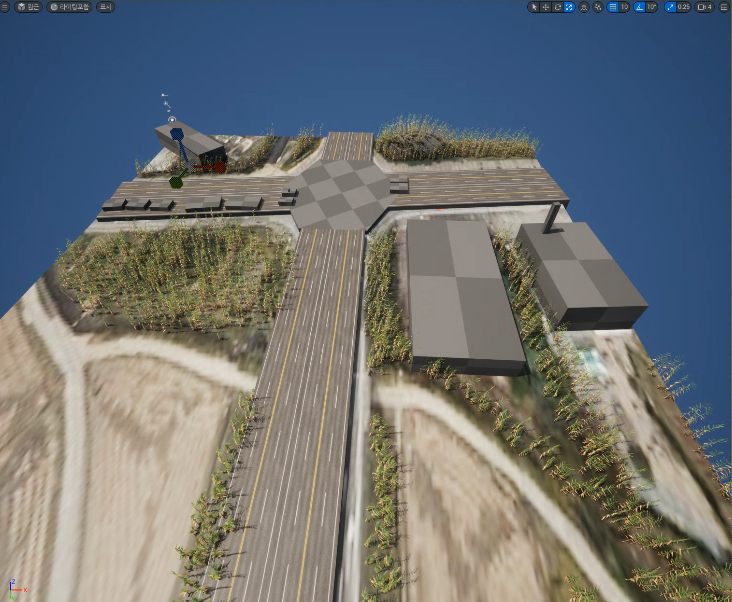

# Unreal Engine 날짜별 제작 과정

수업 과제에서 시작해 지형·마을·도시 장면과 프로젝트 발표로 이어지는 기록입니다.
날짜는 원본 파일명, 사진 촬영 정보, 압축 내부 파일 시각으로 구분했습니다.
파일을 내려받은 11월의 압축파일 이름은 제작 날짜로 사용하지 않았습니다.

## 2026-03-17 — 실내 공간과 조명

소파·테이블·스탠드 등을 배치하고 빛의 색과 위치에 따른 공간 표현을 실습했습니다.
날짜 근거는 과제 1 사진의 촬영 정보 `2026-03-17`입니다. 공개 이미지는 위치 등 사진 메타데이터를 제거한 PNG입니다.

## 2026-04-13 자료 — 지형과 건물 배치

건물의 기본 형태를 잡고 지형 높낮이, 수로와 도로를 함께 구성한 단계입니다.
[다른 방향에서 본 화면](../media/unreal-2026-04-13-03.png)도 보관했습니다.
날짜 근거는 제출 ZIP 내부 이미지 3개의 저장 시각입니다. 정확한 최초 제작일을 뜻하지는 않습니다.

## 2026-05-26 자료 — 마을 환경과 분위기

건물·바위·나무·소품을 배치하고 안개로 깊이와 분위기를 만든 화면입니다.
날짜 근거는 처음 제공된 작업 스크린샷의 파일명입니다.

| 시점 | 화면 |
| --- | --- |
| 마을 전체 배치 | [전경 이미지](../media/unreal-village-wide.png) |
| 수면과 건물의 관계 | [물가 이미지](../media/unreal-village-riverside.png) |

위 두 추가 이미지에는 날짜가 없어 같은 환경의 다른 시점으로 소개하며, 특정 일자에 제작했다고 단정하지 않습니다.

## 2026-06-02 자료 — 도시 장면과 플레이 시점

건물, 차량, 인물과 네온·가로등을 배치한 도시 장면입니다.
마을과 다른 공간 구성과 조명 분위기를 비교할 수 있습니다.

[장면 시연 영상](https://github.com/seung-gwan/game-dev-studies/releases/download/showcase-2026-06/unreal-apocalypse-2026-06-02.mp4)

날짜 근거는 이미지 파일명의 `0602`와 제출 ZIP의 AVI 저장 시각입니다.

## 2026-06-04 자료 — 아포칼립스 프로젝트 발표

[발표·프로젝트 소개 영상](https://github.com/seung-gwan/game-dev-studies/releases/download/showcase-2026-06/unreal-apocalypse-2026-06-04.mp4)

발표 자료에는 PC용 좀비 디펜스/FPS 구상과 구역을 빼앗길수록 적의 접근 방향이 늘어나는 설계를 설명했습니다.
발표 영상에는 슬라이드와 환경 탐색 장면이 포함되어 있습니다.
설계 소개와 실제로 확인한 구현을 구분해 [아포칼립스 기획 정리](unreal-apocalypse-design.md)에 적었습니다.
날짜 근거는 발표 영상의 원본 파일명입니다.

## 날짜가 남지 않은 초기 과제

### 과제 2 — 실내 카메라 이동

[실내 카메라 영상](https://github.com/seung-gwan/game-dev-studies/releases/download/showcase-2026-06/unreal-assignment-02.mp4)

기둥과 창, 실내 소품을 둔 공간을 카메라로 이동하며 살펴보는 약 13초의 기록입니다.
정확한 제출 날짜를 확인할 수 없어 과제 번호로 표시했습니다.

### 과제 3 — 도로·농경지 블록아웃

참고 이미지를 바탕으로 도로, 건물의 기본 덩어리와 식생을 배치한 실습입니다.
과제 번호와 화면은 확인했으며 날짜는 별도로 추정하지 않았습니다.

### 과제 4 — 좀비 디펜스 브레인스토밍

농장·집·작물·우물·울타리를 배경으로 한 웨이브 구상을 기록했습니다.
날씨에 따른 가시거리, 지형에 따른 이동 속도, 주택 보강과 탈출·게임오버 조건은 기획 아이디어로 남긴 내용입니다.
최종 발표의 구역 방어 구상과 함께 [기획 정리](unreal-apocalypse-design.md)에서 확인할 수 있습니다.
