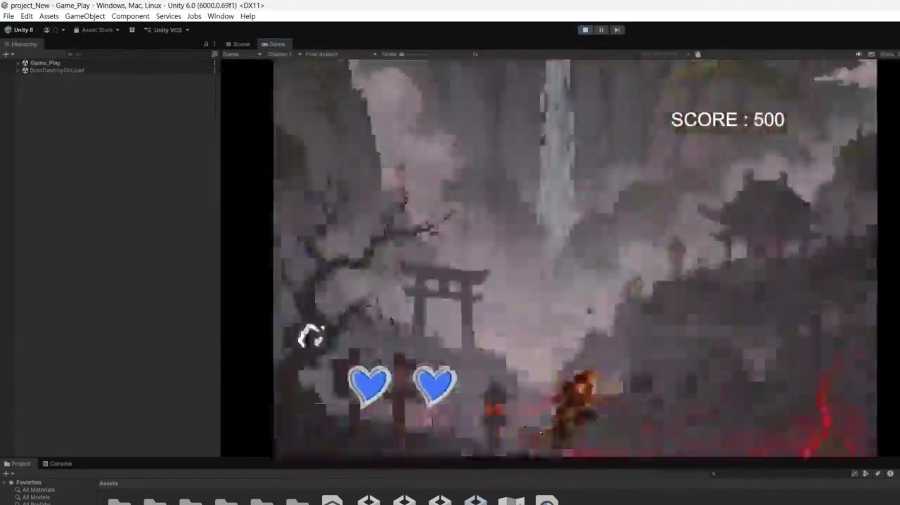
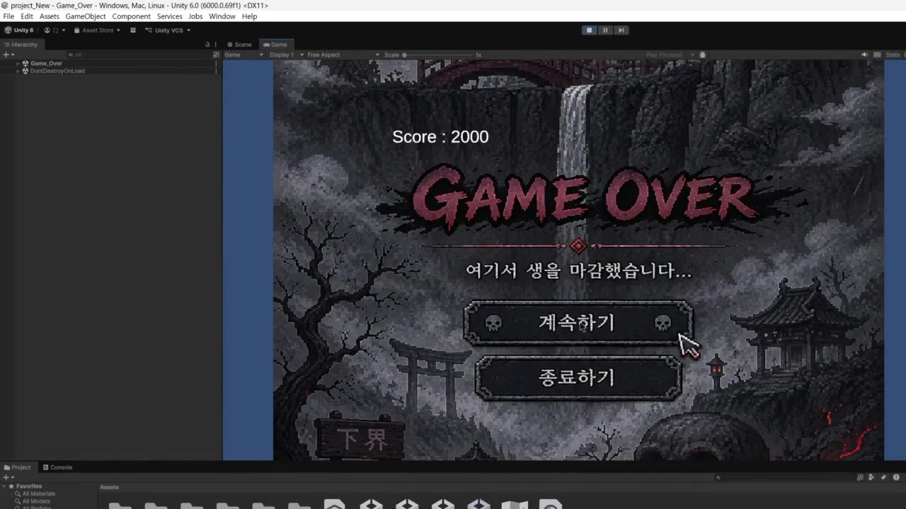

# 손오공 — Unity 2D 액션 팀 프로젝트

**낙하물을 공격·방어·회피하며 점수를 얻는 PC용 미니게임**

[최종 시연 영상](https://github.com/seung-gwan/game-dev-studies/releases/download/showcase-2026-06/unity-final-gameplay.mp4) · [C# 코드](Assets/script) · [전체 학습 목록](../README.md)



## 팀과 기여

컴퓨터게임기초 수업의 2인 팀 **화천인재** 프로젝트입니다. 발표 자료의 제작 기간은 3개월입니다.

| 작업 | 담당 |
| --- | --- |
| 게임 기획 | 유승관 · 이승훈 공동 |
| 게임 구현 전반 | 유승관 |
| 이미지 디자인 | 이승훈 |

공동으로 기획한 게임의 C# 로직, UI 동작과 오브젝트·장면 연결을 구현했습니다. 이미지 디자인은 팀원이 담당했습니다.

## 조작과 게임 흐름

| 입력 | 동작 |
| --- | --- |
| ← / → | 왼쪽·가운데·오른쪽 레인 이동 |
| ↑ | 바닥 상태에서 점프 |
| Z | 공격 범위의 낙하물을 파괴 |
| X | 방어하여 일반 낙하물을 위로 튕김 |

```text
Game_Start → Game_manual → Game_Play → Game_Over
```

점수가 1,000점 이상이면 위험 낙하물과 사전 경고 UI가 등장합니다.
체력이 0이 되면 최종 점수를 저장하고 게임오버 화면으로 이동합니다.
제공된 최종 영상에서는 점수 증가, 체력 변화, 경고·위험 낙하물과 최종 점수 2,000의 게임오버 화면을 확인할 수 있습니다.

## 주요 코드

| 파일 | 구현 내용 |
| --- | --- |
| [PlayerJump.cs](Assets/script/PlayerJump.cs) | 레인 이동, 바닥 판정, 점프, 공격·방어, 체력·점수, 사망 처리 |
| [FallingObject.cs](Assets/script/FallingObject.cs) | 일반 낙하물의 충돌과 반사·파괴 판정 |
| [DangerFallingObject.cs](Assets/script/DangerFallingObject.cs) | 위험 낙하물의 피격·파괴 가능 여부 |
| [ObjectSpawner.cs](Assets/script/ObjectSpawner.cs) | 일반 낙하물 생성과 최대 개수 제한 |
| [DangerSpawner.cs](Assets/script/DangerSpawner.cs) | 점수 조건, 레인 선택, 경고 표시 후 위험 낙하물 생성 |
| [GameOverManager.cs](Assets/script/GameOverManager.cs) | PlayerPrefs의 최종 점수를 게임오버 UI에 표시 |
| [MainMenuManager.cs](Assets/script/MainMenuManager.cs) · [ManualManager.cs](Assets/script/ManualManager.cs) | 시작·설명·플레이 장면 연결 |
| [Camera.cs](Assets/script/Camera.cs) | 플레이어 높이를 부드럽게 추적 |
| [FadePanel.cs](Assets/script/FadePanel.cs) · [PixelButtonEffect.cs](Assets/script/PixelButtonEffect.cs) | UI 전환과 버튼 이벤트 |

## 제작 과정

| 자료 시점 | 진행 내용 | 근거 |
| --- | --- | --- |
| 2026-04-30 | 초기 작업 화면 기록 | [4월 30일 스크린샷](../../media/unity-2026-04-30.png)의 원본 파일명 |
| 2026-05-07 | 기본 조작·점프, 공격·방어 모션과 지면 충돌 처리 | 팀활동 보고서의 명시 날짜, [초기 영상](https://github.com/seung-gwan/game-dev-studies/releases/download/showcase-2026-06/unity-2026-05-07-browser.mp4) |
| 2026-06-04 | 점수·체력·위험 낙하물·게임오버가 이어지는 시연 | [6월 4일 영상](https://github.com/seung-gwan/game-dev-studies/releases/download/showcase-2026-06/son-ogong-gameplay.mp4)의 원본 파일명 |
| 2026-06-08~09 자료 | 최종 구동 영상과 발표 자료 정리 | 제출 압축파일에 저장된 원본 수정 시각. 실제 완성일로 단정하지 않음 |

### 지면을 통과하던 문제

5월 7일 보고서에는 캐릭터가 중력의 영향을 받으면서 지면 아래로 계속 떨어졌던 문제가 기록되어 있습니다.
지면과 캐릭터에 박스 콜라이더를 적용해 접촉을 구성한 과정을 남겼습니다.
이후 코드에서는 `Physics2D.Raycast`와 `groundLayer`를 통해 점프 가능한 바닥 상태를 확인합니다.

### 초기 구상과 최종 코드의 구분

초기 보고서의 C 키 필살기 모션은 당시 구상입니다. 현재 보관한 최종 코드의 주요 전투 입력은 Z 공격과 X 방어입니다.

## 결과와 다음 개선점



- 영상과 코드 버전을 함께 묶어 실행 재현성 높이기
- 플레이어 상태·전투·UI의 책임을 나누어 코드 정리하기
- 공격과 접촉 판정이 겹칠 때의 점수·피해 처리 점검하기
- 원본의 Build Settings에 포함된 SampleScene과 실제 시작 장면 순서 점검하기

출처: 학교 `project_New` 프로젝트, 4월 30일 스크린샷, 5월 7일 팀활동 보고서, 6월 시연·발표 자료, 제작자의 역할 설명.
이미지 디자인 원본은 팀원의 작업이며 공개 소스에는 포함하지 않았습니다. 복원 범위는 [실행 안내](../../docs/source-scope.md)를 참고합니다.
