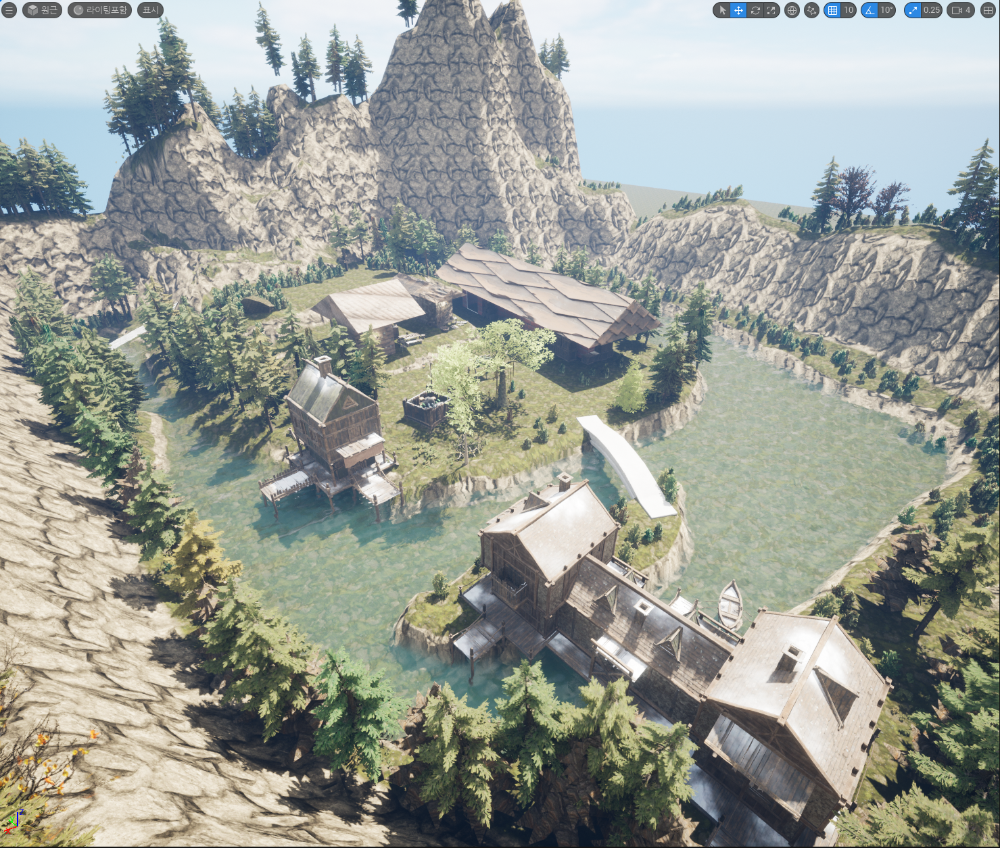

# Unreal Engine — 환경 제작 학습

**실내 공간과 조명 → 지형과 건물 배치 → 마을 환경 → 도시 장면**을 학습한 기록입니다.

[날짜별 제작 과정](../docs/unreal-timeline.md) · [아포칼립스 구상](../docs/unreal-apocalypse-design.md) · [영상 자료](../media/README.md)

## 보관한 프로젝트

| 프로젝트 | 학습 맵 | 관련 자료 |
| --- | --- | --- |
| [test_1](test_1/README.md) | FirstLevel, GoogleEarthMap, HouseLevel, NewTown, NewTown1, NewTown2 | 머티리얼, BP_Level_Move, 레벨 시퀀스, 외부 액터 데이터 |
| [Ch_Test](Ch_Test/README.md) | Level1Map, Level2Map | BP_Level_Move, 외부 액터·오브젝트 데이터 |

두 `.uproject` 파일의 엔진 연결 버전은 **5.0**입니다.
`.umap`, `.uasset`은 Unreal Editor에서 확인하는 바이너리 원본입니다.
`__ExternalActors__`, `__ExternalObjects__`에는 맵에 연결된 저장 데이터가 있으므로 공개본에도 함께 보관했습니다.

## 공부한 내용

- 건물·실내 소품 배치와 조명 변화
- 지형의 높낮이, 도로·건물의 크기와 동선 구성
- 나무·수면·안개를 활용한 마을 환경과 분위기
- 네온·가로등과 건물 배치로 도시 공간 표현
- 카메라 이동 영상과 프로젝트 발표 자료 제작

외부 모델·텍스처·에셋 팩을 활용한 장면 구성입니다. 모든 모델을 직접 제작한 작업으로 소개하지 않습니다.
화면과 학습 과정을 중심으로 설명하며, 블루프린트의 전체 동작이나 게임 완성도는 새로 실행 검증하지 않았습니다.

실행을 위한 외부 리소스와 템플릿 복원은 [소스 범위 안내](../docs/source-scope.md)를 참고합니다.
